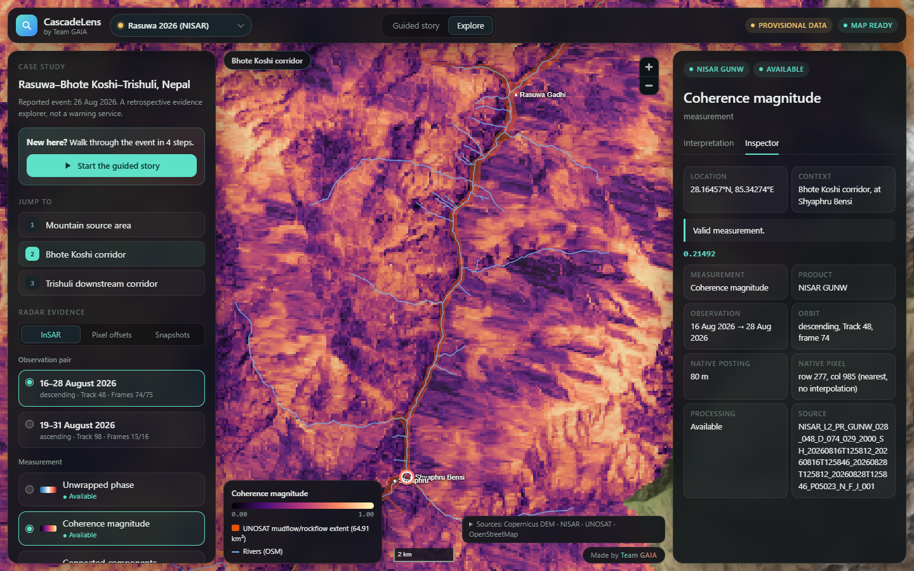
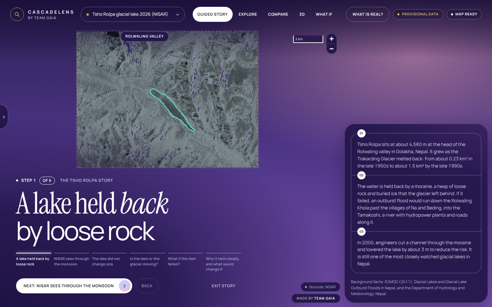

# GAIA CascadeLens

**Following Earth's movement, one radar observation at a time.**

GAIA: Seeing Earth Dance. A Team GAIA project for NASA Space Apps Challenge 2026, Dancing with the SARs.

CascadeLens is a retrospective evidence explorer for the 26 August 2026 Rasuwa–Bhote Koshi–Trishuli disaster in Nepal, with a second case on the Tsho Rolpa glacial lake. It puts NISAR radar measurements on a map with their quality, provenance and limits in view. It is not a warning system.

> **Data status: real NISAR measurements of the event are loaded.** Pair A (GUNW and GOFF) and Pair B (GOFF) passed QA. All are Provisional. GCOV is not downloaded for Rasuwa. No displacement is calculated. See [IMPLEMENTATION_STATUS.md](IMPLEMENTATION_STATUS.md).



## Quick start

Use the finished package, `CascadeLens.zip` (see "Build the package" below). Unzip it to a short path, then:

- **Windows:** double-click **Start CascadeLens.bat**.
- **macOS or Linux:** open a terminal in the unzipped folder and run `sh start.sh`.

It needs Python 3 and no internet connection. To use Brave or another browser, paste the address the launcher prints.

Do not open `index.html` directly. Browsers block a page opened that way from loading its scripts and data, so it cannot start.

## What the radar shows

- **Coherence** is much lower along the UNOSAT-mapped channel than on the terrain beside it: 0.19 against 0.46, and 0.16 against 0.52.
- **At the source**, Pair A has no data, because it falls in a swath gap. Pair B reaches it, and image matching largely fails there: correlation peak 0.18 against 0.63.
- **Raw phase** is dominated by the ionosphere. Removing the product's own estimate cuts scatter by about half to two-thirds.
- **Pixel offsets** show no large coherent shift.

This is evidence to examine, not proof of cause. See [SCIENTIFIC_VALIDATION.md](docs/SCIENTIFIC_VALIDATION.md).

## What works today

- Interactive offline map with Copernicus DEM terrain, UNOSAT event layers, Sentinel-1 damage evidence, OSM geography and district boundaries.
- An opening finding card and a five-step guided story. Their figures are read from the data, not typed in.
- **Can the radar see it?** A per-pixel answer, with reasons, for two separate tasks: seeing a surface change and measuring ground movement. Its first method is under correction, see [IMPLEMENTATION_STATUS.md](IMPLEMENTATION_STATUS.md).
- Real NISAR phase, coherence, connected components, ionosphere screen and pixel offsets, with a labelled ionosphere-removed phase layer.
- A measurement inspector that reads stored raster values, with quality alongside.
- **What could explain this?** Rule-based hypotheses for a clicked spot, with the checks for and against. They are never probabilities.
- A one-click evidence report for any clicked spot: printable page, CSV, GeoJSON and JSON.
- An evidence class on every layer: Observed, Derived, Forecast, Hypothesis, Reference, Scenario or Unknown.
- Experimental hazard screens: landslide-prone terrain, and road stretches with whether the radar could watch them.
- A Simulate mode with a flow replay along the rivers, a what-if flood and a radar explainer. All three are labelled illustrations, not forecasts.
- **What is real?** A status list in the app, generated from one registry, that says which capabilities are complete, experimental or blocked.
- Layer statuses generated from the files on disk. A NISAR layer cannot be selected until it has been downloaded, inspected and passed QA.
- A Python pipeline for GUNW, GOFF and GCOV, with QA gates and provenance.
- Phone layout: the panels become bottom sheets, and the case menu and status list move into the Layers sheet.
- Automated tests at every level, including real browser tests with offline and accessibility checks, and a CI workflow that runs them on every push.

## The Tsho Rolpa case

A second NISAR case, chosen from the Case study menu: a glacial lake in the Rolwaling valley held back by a moraine dam. It has its own six-step story, a comparison of radar images on four dates (16 Aug to 21 Sep 2026), a 3D terrain view and a labelled dam-failure scenario. The measured change in lake area over that period, -0.011 km², is well inside the method's own uncertainty of ±0.091 km², and the app says so.



## Architecture

```text
ASF / Earthdata  ->  Python pipeline (inspect, QA, clip)  ->  COGs, PNG tiles, GeoJSON, manifest.json
                                                                        |
                                              React + MapLibre + geotiff.js (static, no backend)
```

Scientific processing happens before the browser. See [docs/ARCHITECTURE_DECISIONS.md](docs/ARCHITECTURE_DECISIONS.md).

## Run from source

Requires Node 22 or later. The prepared data is in `frontend/public/data`.

```bash
cd frontend
```

```bash
npm install
```

```bash
npm run dev
```

Open http://localhost:5173. For the offline demonstration, which blocks all external requests:

```bash
npm run build
```

```bash
npm run preview
```

## Run the pipeline

Requires Python 3.11 or later.

```bash
python -m venv .venv
```

```bash
.venv/Scripts/python -m pip install -r processing/requirements.txt
```

On macOS or Linux, use `.venv/bin/python`. To rebuild the context layers (no login needed):

```bash
python processing/scripts/fetch_context.py
```

```bash
python processing/scripts/prepare_context.py
```

To rebuild the Simulate mode's flow path:

```bash
python processing/scripts/prepare_simulation.py
```

To add NISAR data (login needed, see [docs/DATA_ACQUISITION.md](docs/DATA_ACQUISITION.md)):

```bash
python processing/scripts/discover_products.py
```

```bash
python processing/scripts/download_products.py --qa-only
```

```bash
python processing/scripts/download_products.py
```

```bash
python processing/scripts/process_nisar.py
```

```bash
python processing/scripts/generate_manifest.py
```

## Test

Every push runs the type check, the unit tests, the Python tests and the browser tests, see [.github/workflows/ci.yml](.github/workflows/ci.yml). To run them yourself:

```bash
python -m pytest tests
```

```bash
cd frontend && npm test
```

Some Python tests are skipped until the data they need is present. To include the real-format tests, first fetch NASA's public samples (about 540 MB, no login):

```bash
python processing/scripts/fetch_samples.py
```

Browser tests use the system Edge. Prepare the fixture and build first:

```bash
python tests/integration/build_fixture.py
```

```bash
cd frontend && npm run build && npm run e2e
```

To use another Chromium browser, such as Brave or Playwright's own Chromium, set `CL_BROWSER_PATH` to its program file. The browser tests also retake the screenshots in `docs/screenshots`.

To explore the NISAR path by hand, on labelled non-Rasuwa data:

```bash
python tests/integration/build_fixture.py --sample
```

```bash
cd frontend && npm run dev:fixture
```

## Build the package

```bash
cd frontend && npm run build
```

```bash
python processing/scripts/build_product.py
```

This writes `CascadeLens.zip` next to the project folder: the built app, the launchers and the source, without raw data.

## The retired LANDMET test

LANDMET, global land weather from 31 December 2007, was an early test that the product could load a dataset it was never designed for. It is no longer listed in the app. Its prepared data, pipeline and tests remain, and this rebuilds it:

```bash
python processing/scripts/prepare_landmet.py path/to/landmet_L3_20071231_v1.nc
```

## Known limitations

All NISAR products are Provisional, and GCOV is not downloaded for Rasuwa. Phase is not converted to displacement. Offsets are radar components, not geographic vectors. UNOSAT and Sentinel-1 layers are preliminary and are not NISAR results. See [docs/LIMITATIONS.md](docs/LIMITATIONS.md).

## Documentation

[Data acquisition](docs/DATA_ACQUISITION.md) · [Adding data to Simulate](docs/ADDING_DATA.md) · [Data sources](docs/DATA_SOURCES.md) · [Methodology](docs/METHODOLOGY.md) · [Scientific validation](docs/SCIENTIFIC_VALIDATION.md) · [Radar observability](docs/RADAR_OBSERVABILITY.md) · [Limitations](docs/LIMITATIONS.md) · [Review and scorecard](docs/REVIEW_AND_SCORECARD.md) · [Data schema](docs/API_AND_DATA_SCHEMA.md) · [Demonstration](docs/DEMONSTRATION.md) · [Plan](docs/IMPLEMENTATION_PLAN.md)

## Licence

Code: MIT, as a default the team can change before publishing. Bundled data keeps its own terms, including CC BY-SA for UNOSAT, ODbL for OSM and CC BY for the Sentinel-1 analyses. See [docs/DATA_SOURCES.md](docs/DATA_SOURCES.md).
